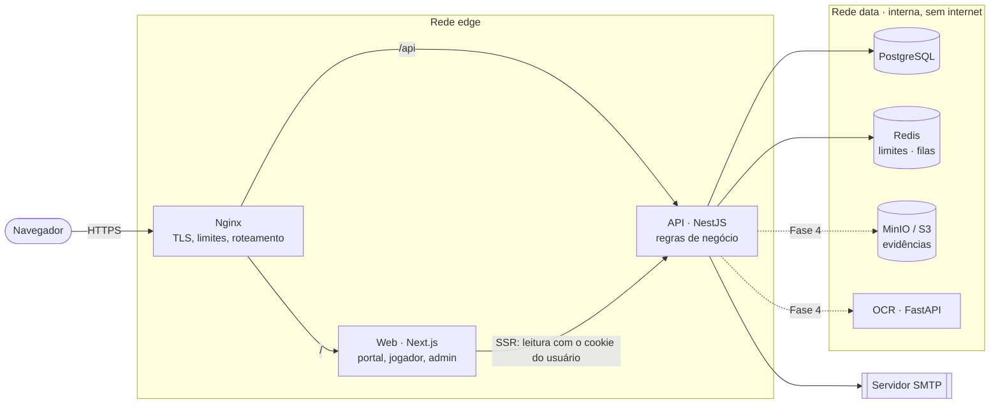
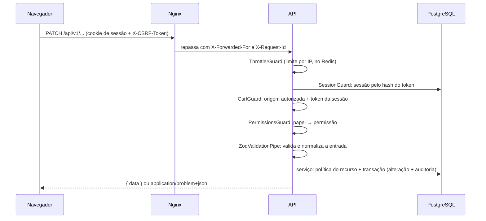
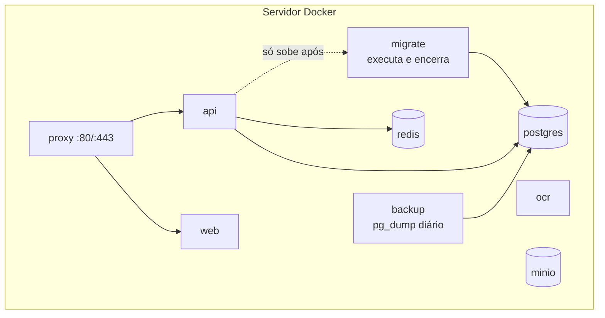

# 02 · Arquitetura

## Visão geral

- **Web (Next.js)** renderiza as telas. Não tem regra de negócio nem acesso ao banco: lê e escreve
  exclusivamente pela API.
- **API (NestJS)** concentra autenticação, autorização, regras e persistência. É o único componente
  que escreve no banco e o único que pode tornar um resultado oficial.
- **OCR (FastAPI)** é um serviço interno e sem estado: recebe uma imagem, devolve campos reconhecidos
  e níveis de confiança. Não acessa banco nem fila (ver `08-estrategia-ocr.md`).
- **PostgreSQL** é a fonte da verdade. **Redis** guarda contadores de limite de requisições e, a
  partir da Fase 4, as filas (BullMQ). **MinIO** guardará as evidências.

Linhas tracejadas indicam integrações planejadas e ainda não implementadas.

## Princípios

1. **Backend como autoridade.** O frontend nunca decide acesso nem calcula classificação.
2. **Domínio separado de infraestrutura.** Regras em serviços e funções puras de política; banco,
   e-mail, fila e armazenamento atrás de módulos de `infra/` substituíveis em teste.
3. **Um contrato, uma fonte.** Schemas Zod em `packages/shared` validam a entrada na API, tipam o
   frontend e geram o OpenAPI.
4. **Histórico só cresce.** Correções são novas versões; nada oficial é editado ou apagado.
5. **Falhar fechado.** Rota sem decorador é autenticada; configuração insegura impede a API de subir
   em produção.

## Fluxo de uma requisição autenticada

A ordem dos guards é fixa (`app.module.ts`): limite → sessão → CSRF → permissões.

## Renderização no frontend

- **Server Components** buscam os dados iniciais chamando a API pela rede interna com o cookie do
  usuário (`serverGet`). O endereço IP e o `X-Request-Id` do cliente são repassados, para que
  auditoria e limites vejam o usuário real e não o servidor web.
- **Componentes cliente** chamam `/api/...` na mesma origem; o cookie HttpOnly nunca é lido pelo
  JavaScript. TanStack Query cuida de cache, recarga e paginação.
- `proxy.ts` faz apenas um redirecionamento otimista (sem cookie → tela de login). A proteção real
  está na API.

## Ambientes

| Ambiente        | Como sobe                                                                          |
| --------------- | ---------------------------------------------------------------------------------- |
| Desenvolvimento | `docker-compose.dev.yml` (infra) + `pnpm dev` (API e web na máquina)               |
| Testes          | Bancos `efed_test` e `efed_e2e`, recriados a partir das migrations a cada execução |
| Produção        | `docker-compose.yml`: tudo em contêineres, só o Nginx publica portas               |

## Implantação (produção)

- **Migrations controladas**: o serviço `migrate` roda `prisma migrate deploy` e encerra; a API só
  inicia se ele terminar com sucesso.
- **Rede `data` interna**: PostgreSQL, Redis, MinIO e OCR não têm porta publicada nem saída para a
  internet.
- **Processos sem privilégios** nas imagens da API, do web e do OCR.
- **TLS obrigatório**: a API exige origens `https://` em produção e usa cookie `__Host-` com `Secure`.
  Certificado: `infrastructure/nginx/certs/README.md`.
- **Health checks** em todos os serviços; política `restart: unless-stopped`; logs com rotação.
- **Backups**: `infrastructure/backup/README.md`.

> A pilha de produção foi validada em sintaxe (`docker compose config`) e seus artefatos foram
> exercitados fora do Docker (pacote da API via `pnpm deploy`, build autocontido do web). A subida
> dos contêineres em si ainda precisa ser executada em um ambiente com Docker — ver `11`.

## Observabilidade

- Logs JSON (pino) com `X-Request-Id` propagado do Nginx até a auditoria; cookies, tokens e
  cabeçalho CSRF são removidos dos logs.
- `GET /api/health` (processo) e `GET /api/health/ready` (PostgreSQL, Redis e MinIO; cada sonda com 2 s de limite).
- Métricas, painéis e alertas: Fase 6.
