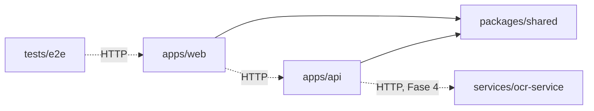

# 03 · Organização do monorepositório

Workspace **pnpm** (sem orquestrador adicional: com três pacotes, `pnpm -r` é suficiente).

```text
efootball-federation/
├── apps/
│   ├── api/                       API REST (NestJS)
│   │   ├── prisma/                schema, migrations e seed de desenvolvimento
│   │   ├── src/
│   │   │   ├── config/            variáveis de ambiente validadas → AppConfig
│   │   │   ├── common/            erros, pipes, paginação, OpenAPI
│   │   │   ├── infra/             prisma, redis, mail, crypto (troca por dublês em teste)
│   │   │   ├── modules/           um diretório por módulo de negócio
│   │   │   └── scripts/           utilitários de operação (criar superadmin, exportar OpenAPI)
│   │   └── test/                  testes de integração (HTTP + PostgreSQL + Redis reais)
│   └── web/                       Next.js
│       └── src/
│           ├── app/               rotas: (site), (auth), painel, admin
│           ├── components/ui/     design system
│           ├── components/layout/ estrutura (menu lateral, cabeçalhos)
│           ├── features/          telas por assunto (auth, security, admin…)
│           └── lib/               cliente da API, sessão, formatação
├── packages/
│   ├── shared/                    contratos compartilhados (Zod, papéis, erros)
│   └── config/                    tsconfig base
├── services/
│   └── ocr-service/               FastAPI (Python)
├── tests/
│   └── e2e/                       Playwright
├── infrastructure/
│   ├── docker/postgres/init/      criação dos bancos de teste (desenvolvimento)
│   ├── nginx/                     proxy reverso de produção
│   ├── backup/                    rotina e instruções de backup/restauração
│   └── monitoring/                reservado para a Fase 6
├── docs/                          documentação e ADRs
├── docker-compose.yml             produção
├── docker-compose.dev.yml         infraestrutura de desenvolvimento
├── .env.example
├── CLAUDE.md
└── README.md
```

## Dependências entre pacotes



- `shared` não depende de nenhum outro pacote e só tem uma dependência (`zod`).
- `web` e `api` **nunca** importam código um do outro; conversam apenas por HTTP, pelo contrato
  descrito em `shared`.
- `shared` é consumido compilado (`dist/`). Por isso `pnpm bootstrap` vem antes de tipos e testes,
  e `pnpm dev` o mantém em modo _watch_.

## Diferenças em relação à estrutura sugerida

| Sugerido                | Adotado                                | Motivo                                                                                 |
| ----------------------- | -------------------------------------- | -------------------------------------------------------------------------------------- |
| `packages/ui`           | `apps/web/src/components/ui`           | Um único consumidor; extrair agora só acrescentaria etapa de build (ADR 0003)          |
| `packages/shared-types` | `packages/shared`                      | Além de tipos, carrega schemas de validação e o mapa de permissões usados em execução  |
| `tests/` (raiz)         | `tests/e2e` + testes ao lado do código | Unitários e de integração ficam junto do que testam; só os end-to-end são transversais |

## Onde colocar código novo

| Preciso de…                          | Vai em…                                                       |
| ------------------------------------ | ------------------------------------------------------------- |
| Formato de entrada ou saída da API   | `packages/shared/src/schemas` ou `dto.ts`                     |
| Regra de negócio                     | `apps/api/src/modules/<módulo>/*.service.ts` ou `*.policy.ts` |
| Acesso a um recurso externo          | `apps/api/src/infra/<recurso>`                                |
| Componente visual reutilizável       | `apps/web/src/components/ui`                                  |
| Tela ou fluxo de um assunto          | `apps/web/src/features/<assunto>` + rota em `src/app`         |
| Teste de fluxo completo no navegador | `tests/e2e/specs`                                             |
