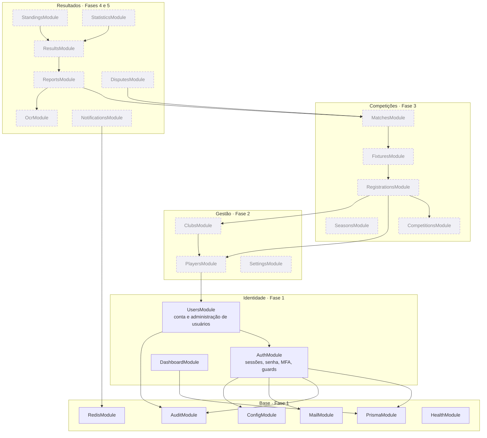

# 04 · Módulos da API

Módulos **implementados** aparecem em linha cheia; os **planejados**, tracejados, com a fase prevista.



## Responsabilidades (Fase 1)

| Módulo            | Responsabilidade                                                                                    | Não faz                       |
| ----------------- | --------------------------------------------------------------------------------------------------- | ----------------------------- |
| `ConfigModule`    | Lê e valida o ambiente uma única vez; expõe `AppConfig`. Recusa configuração insegura em produção.  | Ninguém mais lê `process.env` |
| `PrismaModule`    | Conexão com o PostgreSQL.                                                                           | Regras de negócio             |
| `RedisModule`     | Conexão Redis e armazenamento do limite de requisições.                                             |                               |
| `MailModule`      | Porta `Mailer` + adaptador SMTP; modelos de e-mail.                                                 | Decidir quando enviar         |
| `AuditModule`     | `AuditService.record()` (aceita o cliente da transação) e consulta administrativa.                  | Alterar ou apagar registros   |
| `AuthModule`      | Cadastro, verificação, login, sessões, senha, MFA; `SessionGuard`, `CsrfGuard`, `PermissionsGuard`. | Administrar outras contas     |
| `UsersModule`     | Perfil da própria conta; listagem, papéis e suspensão de usuários, com políticas por recurso.       |                               |
| `DashboardModule` | Indicadores administrativos calculados do banco.                                                    | Guardar números prontos       |
| `HealthModule`    | Liveness e readiness.                                                                               |                               |

## Estrutura interna de um módulo

```text
modules/users/
├── users.module.ts
├── admin-users.controller.ts     HTTP: valida (Zod), documenta (OpenAPI), delega
├── account.controller.ts
├── users-admin.service.ts        caso de uso: carrega, aplica política, transaciona, audita
├── user-admin.policy.ts          regras por recurso — funções puras
└── user-admin.policy.spec.ts     testes unitários das regras
```

- **Controller** não contém regra: recebe a entrada já validada e devolve o envelope `{ data }`.
- **Service** orquestra: busca o estado atual, chama a política, executa a transação.
- **Policy** decide "pode ou não pode" sem tocar em banco — testável em microssegundos.
- DTOs e validações não ficam no módulo: moram em `packages/shared`, porque o frontend usa os mesmos.

## Regras de dependência

- Módulos de negócio dependem dos de base, nunca o contrário.
- Um módulo expõe **serviços**; nenhum módulo acessa as tabelas de outro por fora do serviço dono
  (exceção deliberada: `DashboardModule`, que só lê agregados).
- Dependência circular é sinal de fronteira errada — resolva movendo a regra, não com `forwardRef`.
- O motor de competições (Fase 3) será um conjunto de funções puras dentro de `FixturesModule` e
  `StandingsModule` (round-robin, chaves, desempates), sem dependência de NestJS nem de Prisma, para
  que cada critério seja testado isoladamente.
