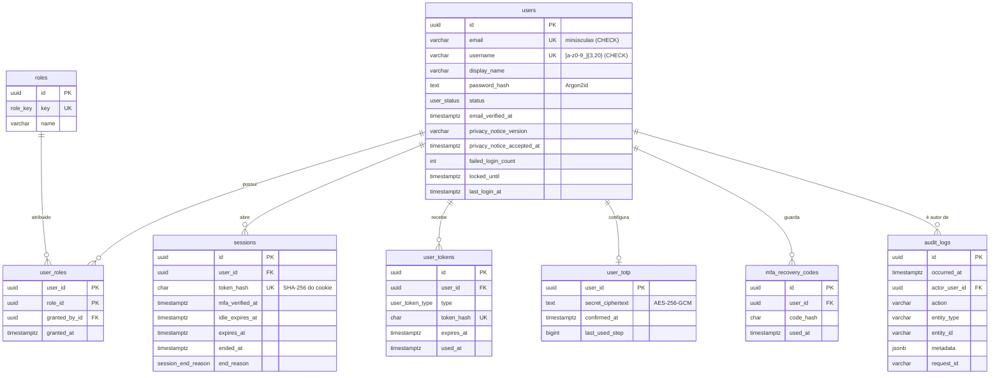
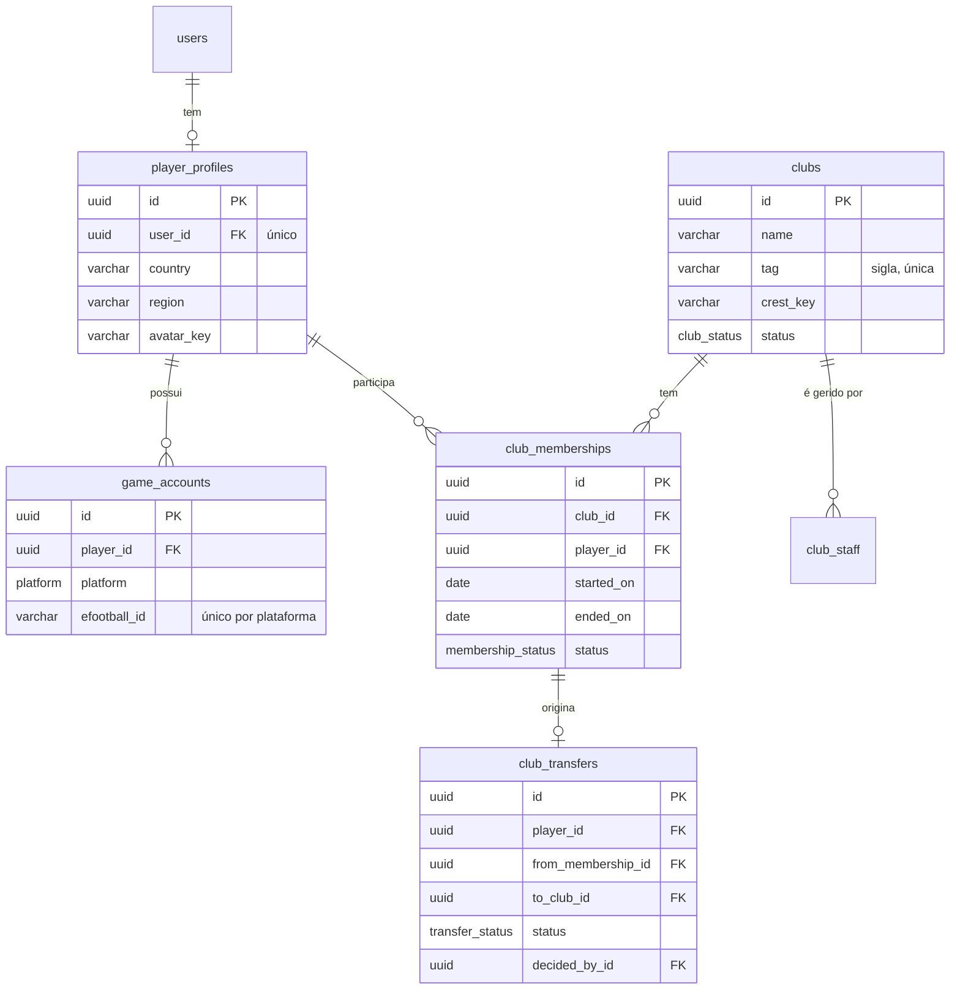
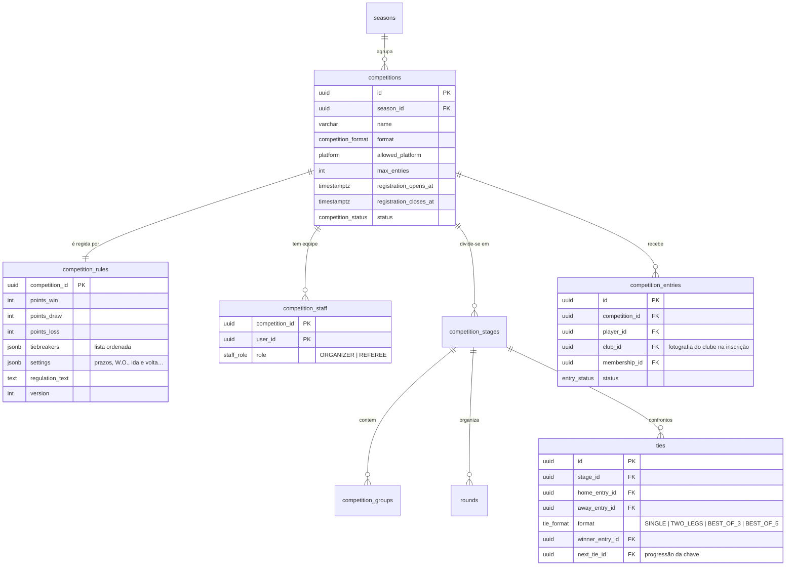
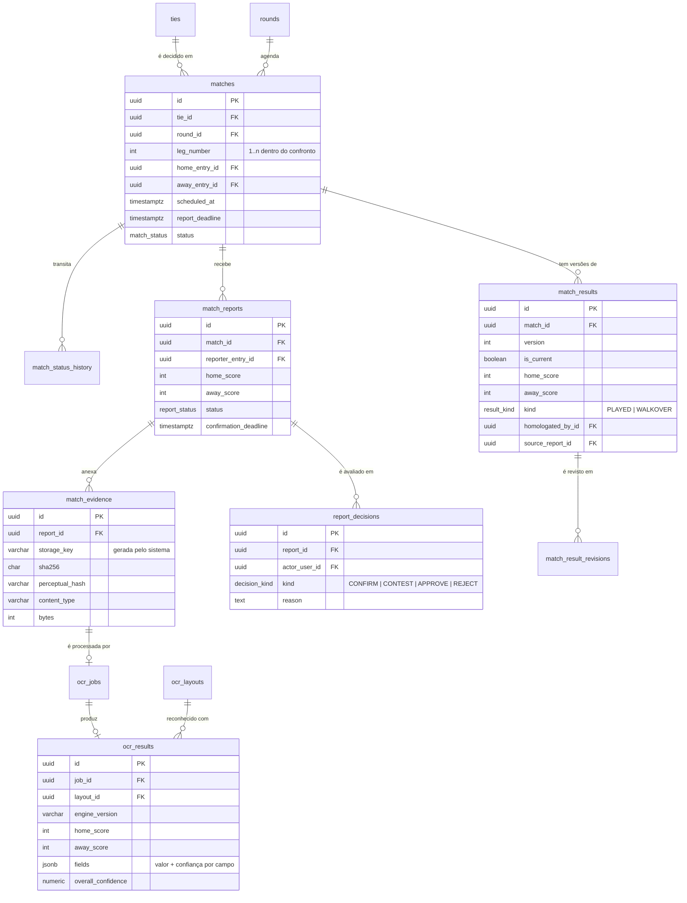

# 05 · Modelo de dados

PostgreSQL 16 com Prisma. Este documento descreve o **modelo inicial completo** (planejamento) e
marca o que **já existe no banco**. Cada fase cria suas tabelas por migration própria.

## Convenções

- Tabelas e colunas em `snake_case`; modelos Prisma em `PascalCase` com `@@map`.
- Chaves primárias **UUID v7** (ordenáveis no tempo: índices mais compactos que UUID v4).
- Datas em `timestamptz(3)`, sempre UTC.
- **`ON DELETE RESTRICT` em todas as chaves estrangeiras.** Nenhuma exclusão em cascata: histórico
  competitivo, resultados e auditoria nunca desaparecem por efeito colateral.
- Registros "apagáveis" são **arquivados** (coluna de estado), não removidos. A eliminação de dados
  pessoais (LGPD) é feita por **anonimização** da linha do usuário.
- Enumerações fechadas e estáveis são `ENUM` do PostgreSQL; listas que mudam com o regulamento
  (critérios de desempate, formatos de pontuação) são configuração em `jsonb` validada por schema.
- O que o Prisma não expressa (CHECK, triggers) é escrito no SQL da migration, com comentário.

## Fase 1 — implementado

Garantias no banco, além das chaves:

| Garantia                                            | Como                                                   |
| --------------------------------------------------- | ------------------------------------------------------ |
| E-mail e nome de usuário sem variação de maiúsculas | `CHECK` + normalização na aplicação                    |
| Sessão encerrada sempre tem motivo (e vice-versa)   | `CHECK ((ended_at IS NULL) = (end_reason IS NULL))`    |
| Auditoria somente de inserção                       | Trigger bloqueia `UPDATE`, `DELETE` e `TRUNCATE`       |
| Papéis presentes em todo ambiente                   | Inseridos pela própria migration (dados de referência) |

## Modelo de leitura do portal — implementado (migration `20260930180000`)

Antecipa o mínimo das Fases 2, 3 e 5 para alimentar a HOME com dados reais. **Classificação, ranking
e estatísticas não têm tabela**: são calculados a partir de partidas homologadas (fonte única,
ADR 0008). Tabelas: `player_profiles`, `clubs`, `club_memberships`, `seasons`, `competitions`,
`competition_entries`, `rounds`, `matches`, `news`, `banners`.

| Garantia                                                         | Como                                      |
| ---------------------------------------------------------------- | ----------------------------------------- |
| Um vínculo ativo por jogador                                     | Índice único parcial (`ended_on IS NULL`) |
| No máximo uma temporada corrente e uma competição em destaque    | Índices únicos parciais                   |
| Partida contra si mesmo impossível; placar em par e entre 0 e 99 | `CHECK`                                   |
| Resultado oficial (`HOMOLOGATED`/`WALKOVER`) exige placar e data | `CHECK matches_official_result_check`     |
| Notícia fora de rascunho tem data de publicação                  | `CHECK news_published_at_check`           |
| Formato de slug, país, sigla e cores                             | `CHECK`                                   |
| Nenhuma exclusão em cascata                                      | `ON DELETE RESTRICT` em todas as chaves   |

## Modelo completo planejado

Visão por domínio. Apenas chaves e colunas que explicam uma decisão estão listadas.

### Jogadores e clubes (Fase 2)

- `player_profiles` separado de `users`: conta de acesso e identidade esportiva mudam por motivos
  diferentes, e nem todo usuário é jogador (árbitros, administradores).
- **Histórico de vínculos**: `club_memberships` nunca é atualizado para "trocar de clube" — o vínculo
  antigo recebe `ended_on` e um novo é criado. Índice único parcial garante **um vínculo ativo por
  jogador**.
- `club_transfers` registra o _pedido_ e a _decisão_; o efeito é a criação do novo vínculo.

### Competições (Fase 3)

- **`competition_entries` guarda a fotografia do vínculo** (`club_id`, `membership_id`). As partidas
  apontam para a inscrição, não para o jogador ou para o clube atual — é isso que impede uma
  transferência de reescrever o passado.
- `competition_staff` dá escopo aos papéis de organizador e árbitro ("as competições às quais
  estiver vinculado").
- Unicidade `(competition_id, player_id)` impede inscrição duplicada; o limite de vagas é verificado
  dentro de uma transação com bloqueio da linha da competição.
- `competition_rules.version` permite saber sob qual regulamento cada resultado foi homologado.

### Partidas, reportes e resultados (Fases 3 a 5)

- **Uma `tie_game` é uma partida.** Em vez da tabela `tie_games` sugerida, `matches` carrega `tie_id`
  e `leg_number`. Todo confronto tem uma `tie`, mesmo em pontos corridos (com uma única partida),
  o que deixa uma só forma de navegar de confronto para jogos.
- **`match_status_history`** (acrescentada) registra cada transição de estado com autor e motivo; as
  transições permitidas ficam em uma máquina de estados no código, coberta por testes.
- **Resultado oficial versionado**: `match_results` nunca é atualizado. Uma correção cria a versão
  seguinte e marca a anterior como não corrente; `match_result_revisions` guarda o porquê. Índice
  único parcial `(match_id) WHERE is_current` torna **impossível haver dois resultados vigentes** —
  é a barreira final contra homologação duplicada.
- `ocr_results` guarda placar em colunas (consultável) e os demais campos com suas confianças em
  `jsonb`, junto com a versão do motor e do layout usados.

### Estatísticas, justiça desportiva e administração (Fase 5)

| Tabela                                 | Observação                                                                                                      |
| -------------------------------------- | --------------------------------------------------------------------------------------------------------------- |
| `standings`                            | **Projeção** recalculável dos resultados oficiais; atualizada na mesma transação da homologação ou da revisão   |
| `player_statistics`, `club_statistics` | Idem: derivadas, podem ser reconstruídas do zero a qualquer momento                                             |
| `rankings`                             | Por escopo (geral, temporada, competição, clubes), com a versão da fórmula usada                                |
| `disputes`, `dispute_evidence`         | Processo com estado, responsável, decisão e justificativa                                                       |
| `dispute_appeals` (acrescentada)       | Recursos administrativos, ligados à decisão recorrida                                                           |
| `disciplinary_actions`                 | Advertência, suspensão etc., com vigência; consultada na validação de inscrições                                |
| `notifications`                        | Unicidade em `(user_id, dedup_key)` impede notificação duplicada para o mesmo evento                            |
| `outbox_events` (acrescentada)         | Eventos gravados na transação de origem e entregues à fila depois — evita perder ou duplicar efeitos colaterais |
| `posts`, `system_settings`             | Notícias do portal e configurações gerais (Fase 2)                                                              |

Tabelas derivadas são um **cache com dono**: a fonte é sempre `match_results`. Um comando de
reconstrução permitirá conferir, a qualquer momento, que a projeção bate com a fonte.

## Ajustes sobre a lista de tabelas sugerida

| Sugerido              | Proposta                                                | Vantagem                                                  |
| --------------------- | ------------------------------------------------------- | --------------------------------------------------------- |
| `tie_games`           | `matches.tie_id` + `leg_number`                         | Uma entidade por fato; sem sincronizar duas tabelas       |
| —                     | `user_tokens`, `user_totp`, `mfa_recovery_codes`        | Necessárias para verificação de e-mail, recuperação e MFA |
| —                     | `competition_staff`                                     | Escopo por competição para organizadores e árbitros       |
| —                     | `match_status_history`                                  | Histórico de alterações da partida, exigido no requisito  |
| —                     | `dispute_appeals`                                       | Recursos administrativos                                  |
| —                     | `outbox_events`                                         | Entrega confiável de notificações e trabalhos de fila     |
| `ocr_processing_logs` | Mantida, com retenção curta                             | Diagnóstico sem inflar `ocr_results`                      |
| `club_transfers`      | Mantida como pedido/decisão; o efeito é um novo vínculo | Histórico de vínculos continua íntegro                    |

## Retenção e privacidade

| Dado                    | Política proposta (a confirmar — decisão D8)                               |
| ----------------------- | -------------------------------------------------------------------------- |
| Sessões encerradas      | Remoção após 90 dias                                                       |
| Tokens de e-mail usados | Remoção após 30 dias                                                       |
| Auditoria               | Preservada; autor anonimizado em caso de eliminação da conta               |
| Evidências (capturas)   | Preservadas enquanto o resultado puder ser contestado + prazo regulamentar |
| Resultados oficiais     | Permanentes (com identificação anonimizável)                               |

As rotinas de expurgo entram na Fase 6; nenhuma remoção automática existe hoje.
