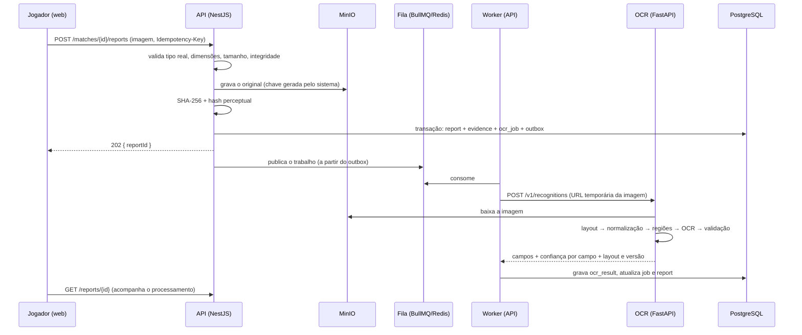

# 08 · Estratégia de processamento OCR

> **Nada deste documento está implementado ainda.** É o desenho da Fase 4. Hoje existe apenas a
> fundação do serviço (`services/ocr-service`, rota `/health`).

## Princípios

1. **O OCR propõe; o backend decide.** O serviço devolve campos e confianças. Homologar é
   responsabilidade exclusiva da API, e confiança alta não homologa sozinha.
2. **Campo não reconhecido é nulo**, nunca inventado.
3. **A imagem original é a evidência** e é preservada intacta; todo processamento usa cópias.
4. **Sem API do jogo.** O fluxo depende apenas da captura enviada pelo participante.
5. **Layouts vêm de capturas reais.** Nenhuma região de interesse é definida por suposição.

## Pré-requisito que trava a Fase 4: o conjunto de capturas

Para definir regiões e medir precisão é preciso um conjunto de referência fornecido pela federação:

- Tela de **resultado final** do eFootball em cada plataforma usada (console, PC, celular).
- As resoluções e proporções mais comuns de cada uma; os idiomas em uso (ao menos português).
- Casos difíceis: foto da TV tirada com o celular, captura cortada, brilho/HDR, prorrogação e pênaltis.
- Para cada imagem, o **gabarito**: placar e nomes corretos (anotados por uma pessoa).

Meta inicial sugerida: 30 capturas por layout, separadas em calibração (70%) e validação (30%).
Sem esse material, a Fase 4 entrega o fluxo (upload, fila, revisão manual), mas não o reconhecimento.

## Arquitetura



### Onde fica a fila

O documento de requisitos lista BullMQ entre as tecnologias do OCR. BullMQ é uma biblioteca Node; a
proposta é que **a fila e o worker fiquem na API** e o serviço Python seja chamado por **HTTP
interno**, sem estado:

| Aspecto          | Worker na API + OCR por HTTP (proposto)                    | Worker Python lendo a fila                            |
| ---------------- | ---------------------------------------------------------- | ----------------------------------------------------- |
| Acesso a dados   | OCR não acessa banco nem Redis (menor privilégio)          | OCR precisa de credenciais do Redis e/ou do banco     |
| Regras           | Persistência e estados ficam em um só lugar, em TypeScript | Estados duplicados em duas linguagens                 |
| Novas tentativas | BullMQ cuida (recuo exponencial, fila de falhas)           | Igual, mas com a porta Python do BullMQ, menos madura |
| Escala           | Réplicas do OCR atrás do nome de serviço                   | Réplicas consumindo a fila                            |

Decisão registrada no ADR 0005; pode ser revista se o volume exigir consumo direto da fila.

## Pipeline de reconhecimento

| #   | Etapa                   | Detalhe                                                                                                    |
| --- | ----------------------- | ---------------------------------------------------------------------------------------------------------- |
| 1   | Identificar o layout    | Proporção e resolução + âncoras visuais (elementos fixos da tela) comparadas com cada modelo cadastrado    |
| 2   | Normalizar              | Correção de perspectiva (foto de tela), redimensionamento para a resolução de referência, contraste        |
| 3   | Recortar regiões        | Coordenadas **normalizadas (0–1)** do modelo → recortes por campo                                          |
| 4   | Pré-processar por campo | Configuração do modelo: binarização, inversão, ampliação, lista de caracteres aceitos (placar: só dígitos) |
| 5   | OCR                     | PaddleOCR por região; leitura genérica da tela inteira só como _fallback_, sempre com confiança rebaixada  |
| 6   | Extrair e validar       | Placar inteiro dentro de limites plausíveis; nomes comparados com os participantes esperados da partida    |
| 7   | Calcular confiança      | Por campo e geral (abaixo)                                                                                 |

### Modelo de layout (`ocr_layouts`)

```jsonc
{
  "id": "efootball-result-console-pt",
  "version": 1,
  "platform": "CONSOLE",
  "referenceResolution": [1920, 1080],
  "language": "pt-BR",
  "anchors": [{ "region": [0.42, 0.05, 0.16, 0.06], "expects": "texto ou padrão fixo" }],
  "fields": {
    "homeScore": {
      "region": [0.0, 0.0, 0.0, 0.0],
      "type": "integer",
      "preprocess": { "threshold": "otsu", "scale": 2 },
    },
    "awayScore": { "region": [0.0, 0.0, 0.0, 0.0], "type": "integer" },
    "homeName": { "region": [0.0, 0.0, 0.0, 0.0], "type": "text" },
    "awayName": { "region": [0.0, 0.0, 0.0, 0.0], "type": "text" },
    "fullTime": { "region": [0.0, 0.0, 0.0, 0.0], "type": "marker" },
  },
}
```

As coordenadas acima estão **zeradas de propósito**: só serão preenchidas a partir das capturas
reais. Cada alteração gera nova versão, e cada resultado guarda o layout e a versão que o produziram.

## Confiança

Por campo, combinando fatores independentes:

| Fator                         | Origem                                                              |
| ----------------------------- | ------------------------------------------------------------------- |
| Confiança do motor            | Pontuação do PaddleOCR para o texto lido                            |
| Reconhecimento do layout      | Quão bem as âncoras casaram                                         |
| Validade do valor             | Placar é inteiro plausível? Marcador de fim de jogo presente?       |
| Compatibilidade com a partida | Nomes lidos correspondem aos participantes esperados?               |
| Consistência entre campos     | Ex.: pênaltis informados só quando o tempo normal terminou empatado |

Faixas iniciais (configuráveis em `system_settings` e **recalibradas com o conjunto de validação**):

| Faixa         | Limite       | Efeito                                                                      |
| ------------- | ------------ | --------------------------------------------------------------------------- |
| Alta          | ≥ 95%        | Placar pré-preenchido; segue para a confirmação do adversário               |
| Intermediária | 80% – 94,99% | Pré-preenchido com destaque; o autor precisa conferir antes de enviar       |
| Baixa         | < 80%        | Digitação manual pelo autor; o reporte é marcado para atenção da arbitragem |

Em nenhuma faixa há homologação automática pelo OCR.

## Upload

- Formatos: PNG, JPEG, WEBP — conferidos pelos **bytes iniciais** e pela decodificação, não pela extensão.
- Limites de tamanho e de dimensões (mínimas e máximas); a imagem é decodificada por completo para
  detectar arquivos truncados ou "bombas de descompressão".
- Nome de armazenamento gerado pelo sistema (`evidence/{ano}/{mês}/{uuid}`); o nome original é só metadado.
- Metadados EXIF removidos das cópias de trabalho (o original permanece intacto, com acesso restrito).
- Acesso à evidência apenas por **URL temporária**, emitida depois da verificação de permissão.

## Antifraude (alertas para análise humana, nunca acusações automáticas)

| Sinal                                  | Como                                                      |
| -------------------------------------- | --------------------------------------------------------- |
| Arquivo idêntico já usado              | SHA-256 igual ao de outra evidência                       |
| Imagem visualmente semelhante          | Distância de Hamming pequena entre hashes perceptuais     |
| Evidência reutilizada em outra partida | Os dois sinais acima cruzados com a partida de origem     |
| Reportes conflitantes                  | Dois lados reportam placares diferentes                   |
| Tentativas incompatíveis               | Vários envios com placares distintos para a mesma partida |
| Incompatibilidade com a partida        | Nomes lidos não correspondem aos participantes            |

Cada sinal vira um alerta ligado ao reporte, visível na central de OCR; a decisão é sempre de uma
pessoa, e a evidência é preservada.

## Medição de qualidade

Conjunto de referência versionado no repositório (imagem + gabarito) e métricas publicadas a cada
alteração do serviço:

- Acerto do **placar completo** (os dois números corretos) — a métrica principal.
- Acerto por campo; taxa de "não reconhecido"; taxa de **erro confiante** (errado com confiança alta),
  que precisa tender a zero.
- Curva de calibração (confiança declarada × acerto real), usada para ajustar as faixas.
- Tempo de processamento por imagem.

## Falhas

| Situação                      | Tratamento                                                                   |
| ----------------------------- | ---------------------------------------------------------------------------- |
| Serviço de OCR fora do ar     | Novas tentativas com recuo; esgotadas, o reporte segue para digitação manual |
| Layout não identificado       | Resultado "não reconhecido" com motivo; fluxo manual                         |
| Imagem ilegível               | Campos nulos; o autor é convidado a enviar outra captura                     |
| Trabalho repetido (reentrega) | Idempotente: um resultado por `ocr_job`                                      |
