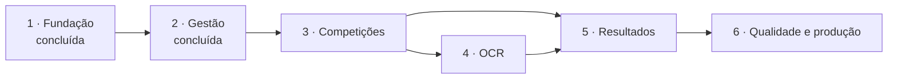

# 10 · Planejamento incremental

Seis fases. Cada uma termina com seus testes executados, os problemas registrados e a documentação
atualizada. **Não se avança com falha crítica aberta.**

A Fase 5 (confirmação, homologação, classificação) depende das partidas da Fase 3, mas **não do
reconhecimento automático**: se as capturas de referência atrasarem, o fluxo de resultados pode ser
construído primeiro com placar digitado e evidência anexada, e o OCR entra depois como assistente.

## Fase 1 — Fundação ✅

Arquitetura e documentação, monorepositório, Docker, PostgreSQL + Prisma, NestJS, Next.js, design
system, autenticação e permissões. Resultado e pendências: `11-fase-1-aceitacao-e-testes.md`.

## Fase 2 — Gestão ✅

Entregue na Etapa B (19/10/2026); decisões D2, D3 e D10 em `adr/0010`. Resultado: `14-aceitacao-sistema-funcional.md`.

| Entrega                   | Conteúdo                                                                                    |
| ------------------------- | ------------------------------------------------------------------------------------------- |
| Perfil de jogador         | Identificação no eFootball, plataforma, país/região, avatar (primeiro uso do MinIO)         |
| Clubes                    | Cadastro, escudo, responsável, situação                                                     |
| Vínculos e transferências | Histórico com início/fim; um vínculo ativo por jogador; pedido e aprovação de transferência |
| Perfis públicos           | Jogador e clube no portal                                                                   |
| Configurações iniciais    | `system_settings` (nome da federação, prazos padrão) e notícias do portal                   |
| Painel                    | Gestão de jogadores, clubes e notícias                                                      |

**Precisa da federação:** D2, D3, D10 (`01`, §6).
**Saída:** critérios 2 a 4 do MVP; transferência não altera vínculos passados (teste); upload de
imagem validado por conteúdo.

## Fase 3 — Competições

| Entrega                  | Conteúdo                                                                                      |
| ------------------------ | --------------------------------------------------------------------------------------------- |
| Temporadas e campeonatos | Ciclo de vida, regulamento versionado, pontuação e desempates configuráveis                   |
| Equipe da competição     | Organizadores e árbitros por competição (escopo dos papéis)                                   |
| Inscrições               | Prazo, vagas, plataforma, suspensão, representação do clube; aprovação quando exigida         |
| Motor de confrontos      | Round-robin (método do círculo), grupos, mata-mata com progressão, ida e volta, melhor de 3/5 |
| Revisão e publicação     | Pré-visualização dos confrontos; publicar é idempotente (não duplica nem perde partidas)      |
| Partidas                 | Máquina de estados formal, calendário, prazos de reporte                                      |

**Precisa da federação:** D5 (prazos e W.O.).
**Saída:** critérios 5 a 9 do MVP; testes de propriedade do motor (todo par se enfrenta exatamente
uma vez; ninguém joga duas vezes na mesma rodada; chave com _byes_ correta); transições inválidas
recusadas.

## Fase 4 — OCR

| Entrega              | Conteúdo                                                                      |
| -------------------- | ----------------------------------------------------------------------------- |
| Upload de evidências | Validação por conteúdo, hashes, armazenamento com nome gerado, URL temporária |
| Fila e worker        | BullMQ, outbox, novas tentativas, fila de falhas                              |
| Serviço de OCR       | Layouts versionados, normalização, regiões, PaddleOCR, validação, confiança   |
| Interface de reporte | Envio pelo celular, acompanhamento, conferência do placar lido                |
| Central de OCR       | Fila, revisão, alertas antifraude, métricas por layout                        |

**Precisa da federação:** **D1 — capturas reais com gabarito.** Sem elas a fase entrega o fluxo, não
o reconhecimento.
**Saída:** critérios 10 a 12 do MVP; métricas no conjunto de validação publicadas; taxa de erro
confiante próxima de zero; upload malicioso recusado (testes).

## Fase 5 — Resultados

| Entrega                   | Conteúdo                                                                        |
| ------------------------- | ------------------------------------------------------------------------------- |
| Confirmação e contestação | Prazo, evidências adicionais, tratamento de não resposta conforme o regulamento |
| Homologação               | Transacional e idempotente; resultado versionado; revisão auditável             |
| Classificação             | Motor de pontuação e desempates; recálculo a partir dos resultados oficiais     |
| Estatísticas e rankings   | Por jogador, clube, temporada e competição; fórmula configurável e documentada  |
| Justiça desportiva        | Processos, decisões, penalidades, recursos                                      |
| Notificações              | Central na plataforma, sem duplicidade; e-mail por fila                         |
| Portal                    | Tabelas, resultados, rankings, histórico de temporadas                          |

**Precisa da federação:** D4, D6.
**Saída:** critérios 13 a 19 do MVP; homologações simultâneas produzem um único resultado (teste de
concorrência); a classificação reconstruída do zero é idêntica à incremental; cada critério de
desempate com teste próprio.

## Fase 6 — Qualidade e produção

| Entrega      | Conteúdo                                                                                           |
| ------------ | -------------------------------------------------------------------------------------------------- |
| Testes       | Cobertura end-to-end dos fluxos principais; acessibilidade automatizada; carga nas rotas críticas  |
| Segurança    | Itens pendentes de `09`; revisão de dependências; teste de intrusão                                |
| Desempenho   | Índices revisados com dados reais; cache das páginas públicas                                      |
| Operação     | Métricas, alertas, logs centralizados; backup externo (banco e evidências) com restauração testada |
| LGPD         | Exportação e anonimização de dados do titular; expurgos                                            |
| Documentação | Manual de operação e de administração                                                              |

**Precisa da federação:** D7, D8, D9.
**Saída:** critério 20 do MVP; restauração de backup ensaiada; ambiente de produção no ar com TLS.

## Como cada fase é conduzida

1. Reler os requisitos da fase e o estado do repositório (`CLAUDE.md`, `docs/`).
2. Fechar com a federação as decisões que a fase exige.
3. Modelo de dados e contratos primeiro (migration + schemas em `shared`), depois regra, depois tela.
4. Testes junto com o código: regra de negócio nunca entra sem teste.
5. Ao final: `pnpm verify`, end-to-end, atualização de `docs/` e um documento de aceitação como o `11`.
